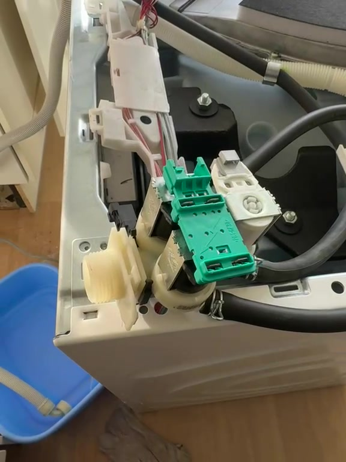

A Bosch washing machine showing **“Check inlet”** is telling you it can't get enough water in. Sometimes the cause is as simple as a tap that's been knocked half-closed. Other times, the problem is inside the machine.

We were recently called out to a Bosch washing machine with exactly this warning. It was struggling to take in enough water, and our engineer traced the fault to the **water inlet valve**. This article explains what the warning means, the checks you can safely do yourself, and how we fixed it.

## What does “Check inlet” mean on a Bosch washing machine?

When a wash starts, the washing machine fills with water up to a set level. It expects to reach that level within a certain time. If the water comes in too slowly, or not at all, the machine stops the programme and shows **“Check inlet”**.

On older Bosch models with a numeric display, the same type of fault is often shown as an error code, such as **F17** or **E17**, rather than a text message. Your user manual will confirm the exact code for your model.

The warning doesn't tell you *why* the water isn't coming in. That's what the checks and diagnosis below are for.

## What causes a Bosch washing machine to fill slowly?

There are two groups of causes: problems with the water supply to the machine, and faults inside the machine itself.

| Symptom | Likely cause | Can you check it yourself? |
| --- | --- | --- |
| No water at all, after plumbing work or moving the machine | Water supply tap closed or only partly open | Yes |
| Slow fill after the machine was pushed back into place | Inlet hose kinked or squashed behind the machine | Yes |
| Slow fill that has got worse over time | Filter mesh in the inlet hose blocked with limescale or debris | Yes, with the tap off and the machine unplugged |
| Slow fill with good water pressure everywhere else | Faulty water inlet valve | No, needs an engineer |
| Water trickling into the drum when the machine is off | Inlet valve not closing properly | No, needs an engineer |
| No water, with the supply on and the hose clear | Faulty inlet valve, a wiring fault or a control fault | No, needs an engineer |

Some Bosch machines also have an **Aquastop** safety hose, which shuts off the water if it detects a leak. If the Aquastop has been triggered, the machine won't fill either. That's another job for an engineer, as the hose usually needs replacing.

## How does a washing machine inlet valve work?

The water inlet valve sits where the inlet hose connects to the back of the washing machine. It controls **when water enters the machine**.

When the programme calls for water, the machine sends a signal to the valve, and the valve opens to let water flow through to the drum. When the drum reaches the right level, the valve closes again.

<figure>
  
  <figcaption>How the inlet valve controls the fill, and why a restricted valve triggers “Check inlet” (shown at 4× speed).</figcaption>
</figure>

If the valve isn't opening properly, less water gets through. The washing machine fills too slowly, runs out of time to reach its water level, and shows the inlet warning. Because the valve is an electrical and mechanical part that opens and closes thousands of times, it can wear out or fail.

## How we diagnosed and fixed this Bosch washing machine

This Bosch washer was struggling to take in enough water and kept showing “Check inlet”.

*With the worktop panel removed, the inlet valve is at the back corner, with its green electrical connector.*

The engineer traced the slow fill to the **water inlet valve**. The old valve was faulty, so it wasn't letting enough water through to fill the machine in time.

We fitted a **new inlet valve** and then tested the washing machine to make sure it was taking in water normally again. The washer passed the test and was back in working order.

<figure>
  
  <figcaption>New valve fitted, water flow checked, normal fill confirmed (shown at 4× speed).</figcaption>
</figure>

## What to do if your washing machine shows an inlet warning

Before you book a repair, these checks are safe to try:

1. **Check the tap.** Make sure the cold water tap or isolation valve feeding the washing machine is fully open. These are easily knocked, especially after other plumbing work.
2. **Check the inlet hose.** Pull the machine out carefully and make sure the hose isn't kinked, twisted or crushed against the wall.
3. **Check your water pressure.** If the kitchen cold tap is also running slowly, the problem may be your water supply rather than the washing machine.
4. **Clean the inlet filter.** Turn the tap off and unplug the machine. Unscrew the inlet hose from the back of the machine and look for a small mesh filter in the inlet. If it's blocked with limescale or grit, rinse it clean and refit the hose firmly.
5. **Restart the programme.** Turn the tap back on, check for leaks around the hose connections, and run a short wash.

If the warning comes back, stop there. The fault is likely inside the machine, and testing an inlet valve involves mains electrical parts. Note the **warning or error code** and the **model number** (usually on a label around the door opening). Both help an engineer arrive prepared.

## Book a Bosch washing machine repair

Our washing machine repairs start from **£75**, which covers the on-site fault diagnosis and labour for the approved repair. If a part such as an inlet valve is needed, we'll explain what has failed and give you a clear quote for the part before any work goes ahead. Parts are charged separately, and if we need to order one, the return visit to fit it is included.

If your Bosch washing machine is slow to fill or showing “Check inlet”, call Ask Appliance Repairs on [07340 002079](tel:+447340002079) or [book a repair](/#contact). We cover West London, Slough, Surrey and nearby areas, 8am to 8pm every day, and you can [check your postcode](/#coverage) on our homepage.

For other washing machine problems, read our guide to [what to do when a washing machine won't drain](/blog/washing-machine-not-draining).
