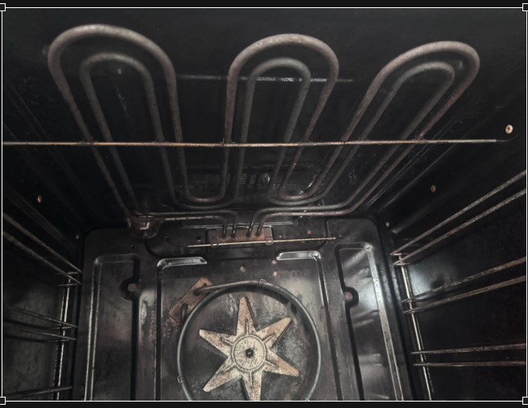
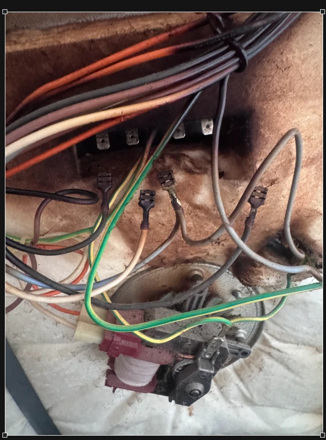
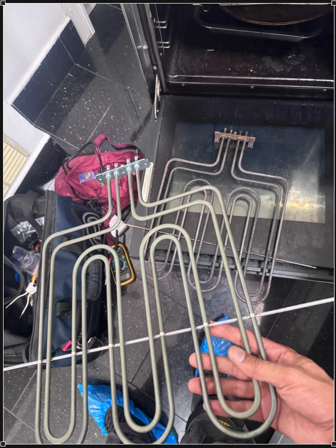

An oven that trips the electrics is one of the more unsettling faults to live with. One minute you're preheating for dinner, the next the lights are off and you're in the hallway resetting the consumer unit.

That's exactly what was happening to one of our customers. Their De'Longhi range cooker, with a gas hob and two electric ovens, had started cutting the power whenever the main oven was switched on. They booked an engineer visit, and this is how we tracked the fault down and put it right.

## The problem: the main oven kept tripping the power

The fault was isolated to the main oven: using it caused the household electrical supply to trip, leaving the oven out of action.

A trip like this is a safety device doing its job. In most homes it's the **RCD** (residual current device), the switch in the consumer unit with a small test button. An RCD watches the current flowing out to an appliance and back again. If some of that current escapes to earth instead, through damaged insulation for example, the RCD cuts the power within a fraction of a second.

So a cooker that trips the RCD is usually telling you that electricity is leaking somewhere it shouldn't. The job is to find exactly where.

## How we diagnosed the fault

An oven has several components that can leak current to earth: the grill element, the fan element behind the back panel, the base element on some models, the fan motor, the wiring and the controls. Swapping parts until the tripping stops is slow and expensive for the customer. Testing each one properly is quicker in the end.

*Inside the main oven: the dual grill element runs across the roof, with the fan element on the back wall.*

With the cooker safely isolated, our engineer:

1. **Talked through the symptoms with the customer.** Knowing that the trip was linked to the main oven narrowed the search straight away.
2. **Inspected the wiring and connections** at the back of the cooker for heat damage, loose terminals or chafed cables.
3. **Carried out insulation resistance tests** on the oven's components.

*Checking the wiring and connections at the back of the cooker during diagnosis.*

An insulation resistance test is the key step for this kind of fault. The engineer disconnects a component and uses a specialist tester to apply a test voltage between its live parts and its metal casing, which is connected to earth. A healthy part shows a very high resistance, meaning almost no current can get through. A faulty part shows a much lower reading, because current is finding a path to earth.

In this case, the **dual grill element** gave a low insulation resistance reading. That was our culprit.

## Why heating elements cause tripping

Oven and grill elements look like solid metal tubes, but inside each one is a coiled heating wire packed in a mineral powder that insulates it from the outer sheath. Over years of heating up and cooling down, that insulation can break down. The sheath can also develop tiny cracks that let moisture in, and damp insulation lets current leak to the earthed casing.

That's why an element can still glow red and heat up perfectly well while being the reason your power keeps tripping. It isn't broken in the obvious sense. It's leaking.

It also explains a pattern many people notice: an oven that only trips when it's first switched on after a few days unused, or one that trips once it has been running for a while. Both point towards insulation that is breaking down.

## The repair: a genuine De'Longhi replacement element

We replaced the faulty dual grill element with a **genuine De'Longhi part**. On a cooker like this we prefer the manufacturer's own part, as it matches the original's fit, terminal layout and power rating exactly.

*The new genuine De'Longhi dual grill element (held up) next to the old element taken out of the oven.*

With the new element fitted, the engineer reconnected the cooker and tested it fully. Everything operated correctly, with no further tripping, and the customer had their main oven back.

## What to do if your oven trips the electrics

If your own cooker has started tripping the power, here's what we'd suggest:

- **Don't keep resetting it and trying again.** Repeated trips mean a fault is still there, and an RCD is a safety device, not a nuisance to work around.
- **Switch the cooker off at its isolator.** This is the large switch on the wall near the cooker, often marked "Cooker".
- **Check that it really is the cooker.** With the cooker isolator off, reset the RCD. If it stays on and trips again only when the cooker is switched back on and used, the cooker is the most likely cause. If it trips with the cooker isolated, the fault is elsewhere in your home, and you'll need an electrician rather than an appliance engineer.
- **Note when it happens.** Does it trip on the grill, the fan oven, or both? Straight away, or after a few minutes? After it hasn't been used for a while? These details help an engineer find the fault faster.
- **Note the make and model number.** It's usually on a label around the oven door frame or on the back of the cooker.
- **Leave the inside of the cooker alone.** Diagnosing a tripping fault involves live mains components and specialist test equipment. Panels should only come off once the cooker is safely isolated, by someone trained to do it.

## Is it worth repairing?

Usually, yes. A range cooker is an expensive appliance, and a single faulty element is a far smaller cost than replacing the whole cooker. The important thing is an accurate diagnosis, so you only pay for the part that has actually failed.

Our cooker and oven repairs start from **£75**, which covers the on-site fault diagnosis and labour for the approved repair. If a part is needed, we'll explain what has failed and give you a clear quote for the part before any work goes ahead. Parts are charged separately, and if we need to order one, the return visit to fit it is included.

If your oven, grill or hob is tripping the electrics, [book a repair](/#contact) or call us. We cover Greater London and Surrey, 8am to 8pm every day, and you can [check your postcode](/#coverage) on our homepage.
